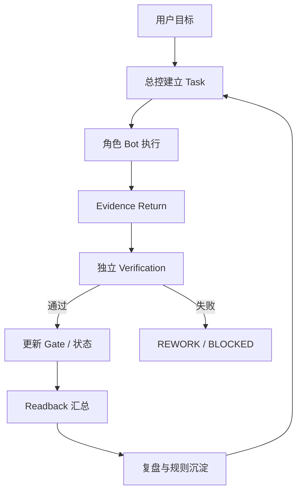

# Bot 集群学习复现框架 v0.1

状态：控制面草案，可审阅；未修改现有 Bot 配置，未创建新 Bot，未启用新执行器。

## 目标

把公开资料中的 Agent 工作方法转化为本集群可执行的协作协议：角色清晰、任务可追踪、证据可回读、结果可验证、失败可回退、经验可复用。

## 已核对的依据

- Cursor Compile London 官方议程：Lauren Tan 的主题为 “I Shipped 2,000 PRs Last Month”。
- pstack 官方 setup：按角色配置模型，并将模型规则写入统一规则文件。
- Grok Bot Galaxy Session Book：可作为 workshop 方法参考；原文明确不是官方 xAI 出版物。
- 内部自动化开发站状态闸口登记表：已定义状态命名空间、BG/KG 闸口、Evidence、Validation、Authorization、Activity 和 M15-A/B 回读边界。

## 核心原则

1. 先设计可验证的环境，再增加 Bot 数量。
2. 每个 Bot 只承担明确角色，不把“模型聪明”当作流程控制。
3. 产出与证据同时返回；没有来源或验证结果就保持 pending。
4. 业务完成、QA 通过、Kernel Validation 通过分别记录。
5. 高风险动作停在 Authorization，不由普通任务自动执行。
6. Readback 只能回读事实源，不能创建第二套状态事实。
7. 复盘中只把重复、稳定、已验证的经验沉淀为规则或 Skill。

## 工作流

## 当前试点顺序

1. 总控、研究、开发、测试、知识管理五类角色。
2. 一个小型海外站页面或模块流程。
3. 先验证任务协议、证据回传、失败阻塞和回读。
4. 三类评测：正常、缺资料/权限、证据不足。
5. 通过后再扩展 SEO、增长、内容、商业分析等角色。

## 暂不做

- 不创建或修改 Bot 配置。
- 不绑定未核实的 owner。
- 不注册平台正式状态枚举。
- 不部署、发布、付款、改 DNS 或操作外部账号。
- 不把未读取的外部资料写成已确认事实。
